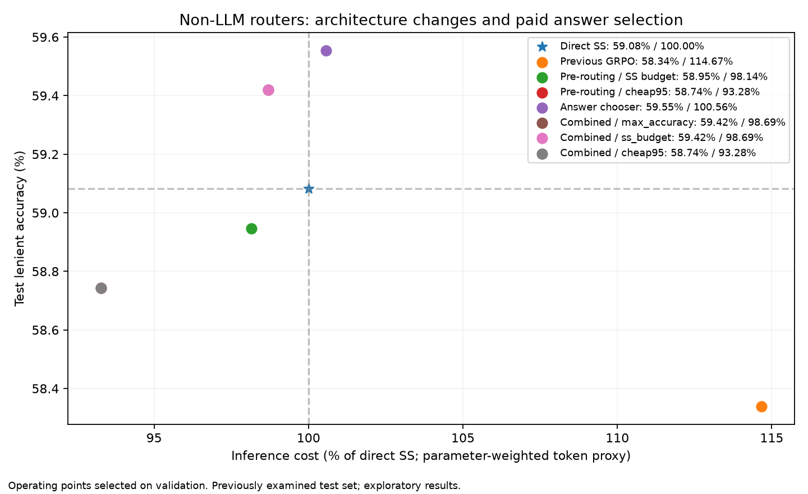

# Combined pre-routing and answer selection

Inherited train-CV models. Operating points locked on validation before test replay. Exploratory follow-up on a previously examined test set.
Strong and weak QA costs are both charged on every initially selected SS route, irrespective of the retained answer.

| Objective | Validation configuration | Val accuracy % | Val cost % SS | Test accuracy % | Strict % | Test cost % SS | Delta SS pp | Paired interval pp |
|---|---|---:|---:|---:|---:|---:|---:|---|
| max_accuracy | lambda_0.0_threshold_0.0 | 60.18 | 99.28 | 59.42 | 47.40 | 98.69 | +0.34 | [-0.1350438892640108, 0.8777852802160702] |
| ss_budget | lambda_0.0_threshold_0.0 | 60.18 | 99.28 | 59.42 | 47.40 | 98.69 | +0.34 | [-0.1350438892640108, 0.8777852802160702] |
| cheap95 | lambda_0.05_no_chooser | 59.55 | 94.18 | 58.74 | 46.79 | 93.28 | -0.34 | [-0.9453072248480756, 0.2700877785280216] |

Recorded per-question parameter-weighted token audit: combined SS-budget cost 98.91% of test direct SS; direct pre-router cheap95 cost 93.57%; post-answer chooser cost 100.57%. CPU router overhead remains excluded.

Combined SS-budget corrected 10 direct-SS errors and introduced 5 errors (net +5/1481). Its paired interval includes zero; stable superiority is not established.

