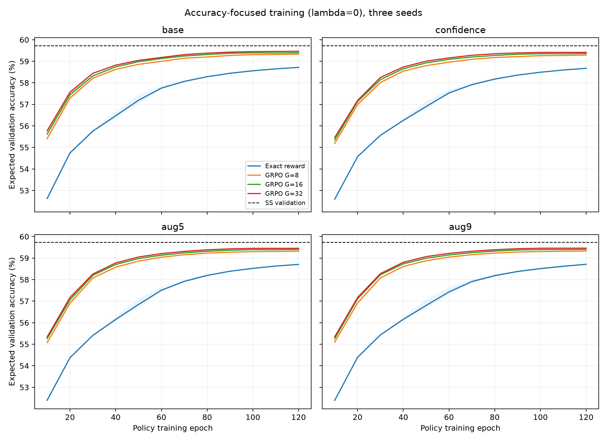
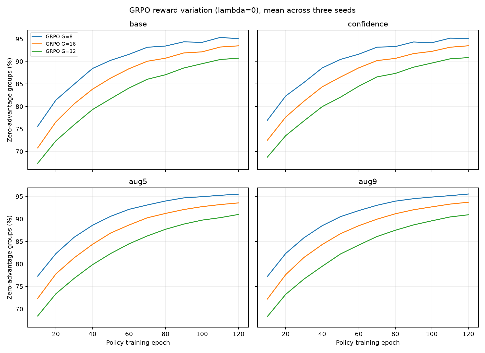
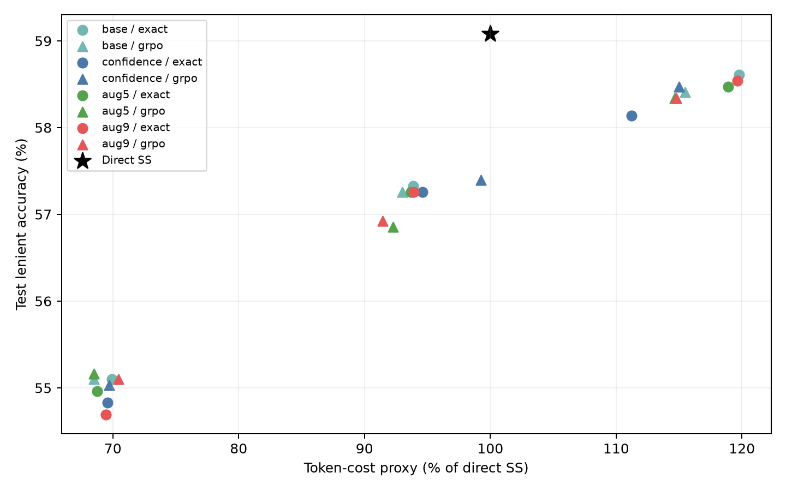

# Extended non-LLM policy experiments

144 seed-specific training runs; 144 three-seed checkpoint/configuration candidates evaluated on validation. 24 predeclared family/objective winners evaluated on the previously used descriptive test set.
Heads are linear over TF-IDF and numeric features. Qwen weights are unchanged. Every deployed policy sees one greedy weak answer, including augmented-training policies.
Training uses one, five or nine observation bundles per question; all questions have equal total weight. Maximum accuracy and SS-budget objectives are selected on validation, not test.
Costs are parameter-weighted token proxies including sunk weak calls, excluding CPU router overhead. Confidence costs assume extraction from normal generation logits.

SS test lenient accuracy: **59.08%**.

| Family / objective | G | λ | Epoch | Val acc % | Val cost % SS | Test acc % | Test strict % | Test cost % SS | Δ vs SS (pp) | Paired 95% interval |
|---|---:|---:|---:|---:|---:|---:|---:|---:|---:|---|
| base_exact_cheap95 | 0 | 0.0 | 60 | 56.76 | 71.80 | 55.10 | 43.96 | 69.92 | -3.98 | [-5.54, -2.50] |
| base_exact_max_accuracy | 0 | 0.15 | 120 | 59.91 | 119.37 | 58.61 | 46.73 | 119.77 | -0.47 | [-0.95, -0.07] |
| base_exact_ss_budget | 0 | 0.15 | 120 | 59.64 | 97.29 | 57.33 | 45.58 | 93.88 | -1.76 | [-2.84, -0.74] |
| base_grpo_cheap95 | 8 | 0.0 | 120 | 56.76 | 71.37 | 55.10 | 43.82 | 68.48 | -3.98 | [-5.54, -2.43] |
| base_grpo_max_accuracy | 32 | 0.0 | 120 | 60.00 | 115.80 | 58.41 | 46.39 | 115.49 | -0.68 | [-1.28, -0.13] |
| base_grpo_ss_budget | 8 | 0.0 | 30 | 59.01 | 96.89 | 57.26 | 45.31 | 93.00 | -1.82 | [-2.90, -0.81] |
| confidence_exact_cheap95 | 0 | 0.0 | 60 | 56.76 | 70.38 | 54.83 | 43.82 | 69.56 | -4.25 | [-5.87, -2.77] |
| confidence_exact_max_accuracy | 0 | 0.0 | 30 | 59.91 | 112.73 | 58.14 | 46.39 | 111.21 | -0.95 | [-1.62, -0.27] |
| confidence_exact_ss_budget | 0 | 0.15 | 120 | 59.55 | 98.60 | 57.26 | 45.58 | 94.60 | -1.82 | [-2.84, -0.81] |
| confidence_grpo_cheap95 | 8 | 0.0 | 30 | 56.76 | 70.90 | 55.03 | 43.96 | 69.70 | -4.05 | [-5.60, -2.50] |
| confidence_grpo_max_accuracy | 16 | 0.0 | 120 | 60.00 | 115.55 | 58.47 | 46.46 | 114.98 | -0.61 | [-1.22, -0.07] |
| confidence_grpo_ss_budget | 32 | 0.15 | 60 | 59.01 | 99.78 | 57.39 | 45.78 | 99.26 | -1.69 | [-2.63, -0.74] |
| aug5_exact_cheap95 | 0 | 0.0 | 30 | 56.76 | 71.60 | 54.96 | 43.96 | 68.76 | -4.12 | [-5.60, -2.70] |
| aug5_exact_max_accuracy | 0 | 0.0 | 60 | 59.91 | 118.69 | 58.47 | 46.73 | 118.88 | -0.61 | [-1.08, -0.14] |
| aug5_exact_ss_budget | 0 | 0.15 | 120 | 59.46 | 97.37 | 57.26 | 45.51 | 93.68 | -1.82 | [-2.90, -0.81] |
| aug5_grpo_cheap95 | 8 | 0.0 | 120 | 56.76 | 71.93 | 55.17 | 43.96 | 68.51 | -3.92 | [-5.54, -2.36] |
| aug5_grpo_max_accuracy | 16 | 0.0 | 120 | 60.18 | 115.09 | 58.34 | 46.32 | 114.67 | -0.74 | [-1.35, -0.14] |
| aug5_grpo_ss_budget | 8 | 0.0 | 30 | 59.19 | 96.49 | 56.85 | 44.97 | 92.25 | -2.23 | [-3.31, -1.15] |
| aug9_exact_cheap95 | 0 | 0.0 | 60 | 56.76 | 70.92 | 54.69 | 43.69 | 69.45 | -4.39 | [-5.94, -2.90] |
| aug9_exact_max_accuracy | 0 | 0.15 | 120 | 60.00 | 119.31 | 58.54 | 46.73 | 119.66 | -0.54 | [-1.01, -0.07] |
| aug9_exact_ss_budget | 0 | 0.15 | 120 | 59.55 | 97.40 | 57.26 | 45.51 | 93.91 | -1.82 | [-2.90, -0.81] |
| aug9_grpo_cheap95 | 8 | 0.0 | 30 | 56.76 | 71.64 | 55.10 | 44.02 | 70.46 | -3.98 | [-5.54, -2.50] |
| aug9_grpo_max_accuracy | 8 | 0.0 | 120 | 60.00 | 115.25 | 58.34 | 46.32 | 114.79 | -0.74 | [-1.35, -0.14] |
| aug9_grpo_ss_budget | 8 | 0.0 | 30 | 59.01 | 95.79 | 56.92 | 45.04 | 91.46 | -2.16 | [-3.24, -1.01] |

Global validation selections:

- cheap95: confidence_exact_cheap95
- max_accuracy: aug5_grpo_max_accuracy
- ss_budget: base_exact_ss_budget

Training curves record validation expected accuracy/cost and GRPO zero-advantage group frequency every 10 epochs. Only epochs 30/60/120 participate in configuration selection.
This is a finite-action GRPO adaptation, with the same entropy regularizer as exact optimization. Increased validation search and previously examined test data limit confirmatory claims. Bootstrap intervals are descriptive and not adjusted for multiple comparisons.

