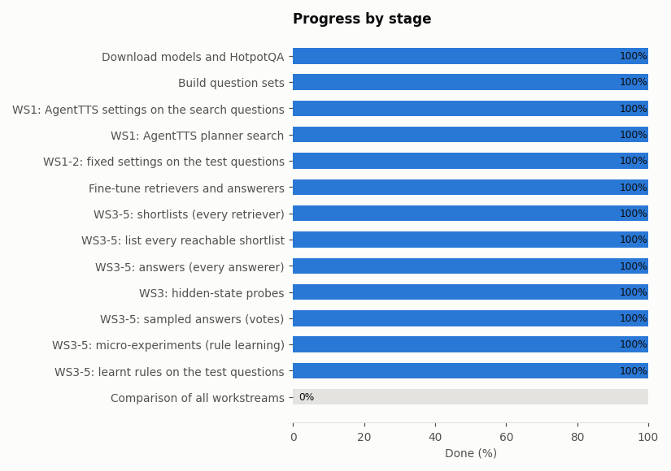
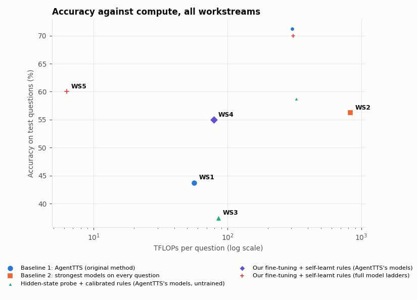
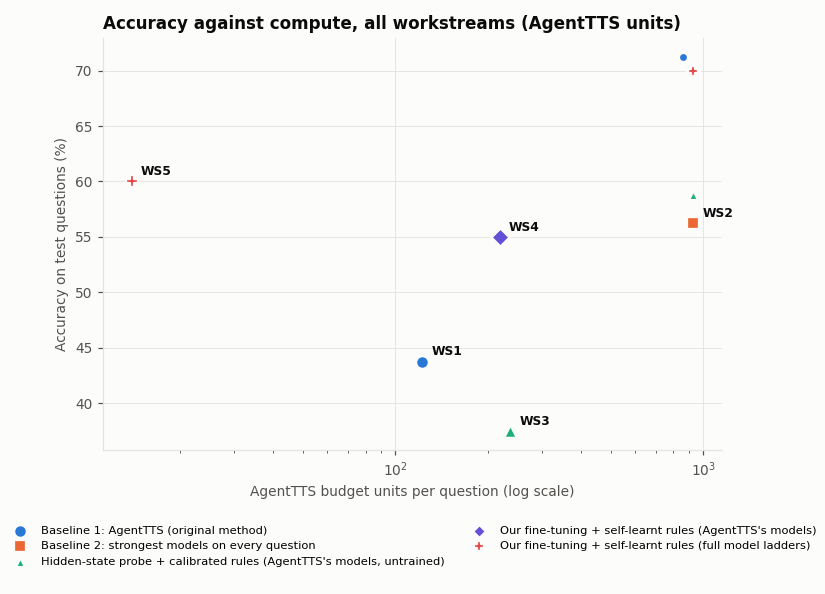
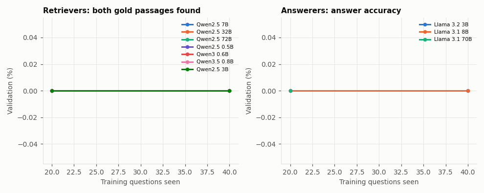
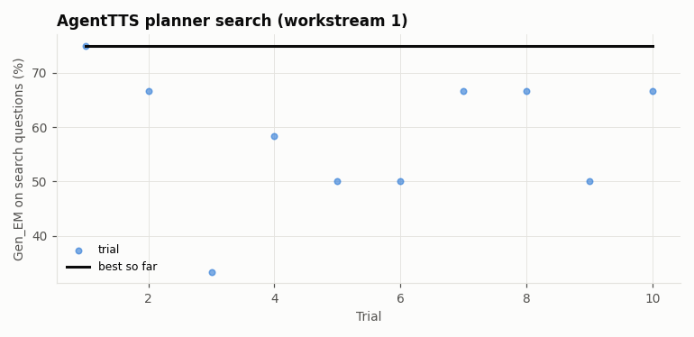

# STAIR: self-learnt switching, run `dryrun`

**Updated Fri 16 Oct 2026, 12:48 (Singapore time).** Overall ████████████ 100%. **Estimated finish: Fri 16 Oct, 13:00** (about 0 h left; planned stage times, corrected by measured speed as stages run).

Branch `selfLearnt-runs` holds only this status page and is replaced at every update. Code: branch `selfLearnt`.

## Stages

| # | Stage | State | Progress | Running now |
|---|---|---|---|---|
| 1 | Download models and HotpotQA | ✅ done | ██████████ 100% |  |
| 2 | Build question sets | ✅ done | ██████████ 100% |  |
| 3 | WS1: AgentTTS settings on the search questions | ✅ done | ██████████ 100% |  |
| 4 | WS1: AgentTTS planner search | ✅ done | ██████████ 100% |  |
| 5 | WS1-2: fixed settings on the test questions | ✅ done | ██████████ 100% |  |
| 6 | Fine-tune retrievers and answerers | ✅ done | ██████████ 100% |  |
| 7 | WS3-5: shortlists (every retriever) | ✅ done | ██████████ 100% |  |
| 8 | WS3-5: list every reachable shortlist | ✅ done | ██████████ 100% |  |
| 9 | WS3-5: answers (every answerer) | ✅ done | ██████████ 100% |  |
| 10 | WS3: hidden-state probes | ✅ done | ██████████ 100% |  |
| 11 | WS3-5: sampled answers (votes) | ✅ done | ██████████ 100% |  |
| 12 | WS3-5: micro-experiments (rule learning) | ✅ done | ██████████ 100% |  |
| 13 | WS3-5: learnt rules on the test questions | ✅ done | ██████████ 100% |  |
| 14 | Comparison of all workstreams | ⏳ waiting | ░░░░░░░░░░ 0% |  |

## Results so far (80 AgentTTS test questions)

Accuracy = AgentTTS's metric (gold answer contained in the final response). Corrected label = our development label on the short answer (workstreams 3-5 only). Budget = AgentTTS's normalised compute units per question; TFLOPs = 2 x parameters x tokens actually processed. Baseline 1 = AgentTTS with the setting its own search chose.

| Workstream | Policy | Accuracy | Corrected label | Budget / question | TFLOPs / question | vs Baseline 1: accuracy (points) | compute |
|---|---|---|---|---|---|---|---|
| WS1 | **Baseline 1: AgentTTS (setting chosen by its search): Qwen2.5 7B x10 -> Llama 3.2 3B x1 (+ fusion)** | **43.8%** | - | 122.3 | 56.36 | +0.0 | +0% |
| WS1 | AgentTTS's reported best setting: Qwen2.5 72B x1 -> Llama 3.2 3B x40 (+ fusion) | 71.2% | - | 856.0 | 305.18 | +27.5 | +441% |
| WS2 | **Baseline 2: strongest models: Qwen2.5 72B x1 -> Llama 3.1 70B x1 (+ fusion)** | **56.2%** | - | 928.7 | 831.43 | +12.5 | +1375% |
| WS3 | Fixed: Qwen2.5 7B -> Llama 3.2 3B (cheapest) | 38.8% | 38.8% | 80.3 | 30.81 | -5.0 | -45% |
| WS3 | Fixed: Qwen2.5 72B -> Llama 3.1 70B (largest) | 58.8% | 58.8% | 928.7 | 325.18 | +15.0 | +477% |
| WS3 | Fixed: Qwen2.5 32B -> Llama 3.1 70B (best fixed pipeline on dev) | 52.5% | 52.5% | 475.3 | 174.38 | +8.8 | +209% |
| WS3 | Starting rulebook (before any micro-experiment) | 37.5% | 37.5% | 236.4 | 85.51 | -6.2 | +52% |
| WS3 | **LEARNT rulebook (v2, 2 rounds)** | **37.5%** | 37.5% | 236.4 | 85.51 | -6.2 | +52% |
| WS4 | Fixed: Qwen2.5 7B (fine-tuned) -> Llama 3.2 3B (fine-tuned) (cheapest) | 53.8% | 53.8% | 80.3 | 30.13 | +10.0 | -47% |
| WS4 | Fixed: Qwen2.5 72B (fine-tuned) -> Llama 3.1 70B (fine-tuned) (largest) | 70.0% | 70.0% | 928.7 | 308.89 | +26.2 | +448% |
| WS4 | Fixed: Qwen2.5 72B (fine-tuned) -> Llama 3.1 70B (fine-tuned) (best fixed pipeline on dev) | 70.0% | 70.0% | 928.7 | 308.89 | +26.2 | +448% |
| WS4 | Starting rulebook (before any micro-experiment) | 55.0% | 55.0% | 218.5 | 78.90 | +11.3 | +40% |
| WS4 | **LEARNT rulebook (v2, 2 rounds)** | **55.0%** | 55.0% | 218.5 | 78.90 | +11.3 | +40% |
| WS5 | Fixed: Qwen2.5 0.5B (fine-tuned) -> Llama 3.2 3B (fine-tuned) (cheapest) | 52.5% | 52.5% | 6.7 | 3.43 | +8.8 | -94% |
| WS5 | Fixed: Qwen2.5 72B (fine-tuned) -> Llama 3.1 70B (fine-tuned) (largest) | 70.0% | 70.0% | 928.7 | 308.89 | +26.2 | +448% |
| WS5 | Fixed: Qwen3.5 0.8B (fine-tuned) -> Llama 3.1 70B (fine-tuned) (best fixed pipeline on dev) | 52.5% | 52.5% | 121.7 | 36.87 | +8.8 | -35% |
| WS5 | Starting rulebook (before any micro-experiment) | 60.0% | 60.0% | 13.9 | 6.27 | +16.2 | -89% |
| WS5 | **LEARNT rulebook (v2, 2 rounds)** | **60.0%** | 60.0% | 13.9 | 6.27 | +16.2 | -89% |

- **WS3** learnt rulebook: 0 of 20 changes accepted; vs random escalation of the same size -4.7 points (-11.6 to +2.0); Sure on 34% of questions, right 100.0% of the time when Sure.
- **WS4** learnt rulebook: 0 of 34 changes accepted; vs random escalation of the same size -0.2 points (-7.3 to +6.7); Sure on 52% of questions, right 97.6% of the time when Sure.
- **WS5** learnt rulebook: 0 of 34 changes accepted; vs random escalation of the same size +3.0 points (-3.7 to +9.8); Sure on 55% of questions, right 100.0% of the time when Sure.

## AgentTTS search (workstream 1)

10 trials within budget 900. Chosen: **Qwen2.5 7B x10 retrieval samples, Llama 3.2 3B x1 answer samples** (Gen_EM 0.750 on the 50 search questions, budget 122).

## Fine-tuning

Validation: retrievers = both gold passages in the shortlist; answerers = corrected-label accuracy.

| Model | Questions seen | Best validation | State |
|---|---|---|---|
| Qwen2.5 7B | 40 | 0.0% (step 10) | chosen |
| Qwen2.5 32B | 20 | 0.0% (step 5) | chosen |
| Qwen2.5 72B | 20 | 0.0% (step 5) | chosen |
| Llama 3.2 3B | 40 | 0.0% (step 10) | chosen |
| Llama 3.1 8B | 40 | 0.0% (step 10) | chosen |
| Llama 3.1 70B | 20 | 0.0% (step 5) | chosen |
| Qwen2.5 0.5B | 40 | 0.0% (step 10) | chosen |
| Qwen3 0.6B | 40 | 0.0% (step 10) | chosen |
| Qwen3.5 0.8B | 40 | 0.0% (step 10) | chosen |
| Qwen2.5 3B | 40 | 0.0% (step 10) | chosen |

## Charts

